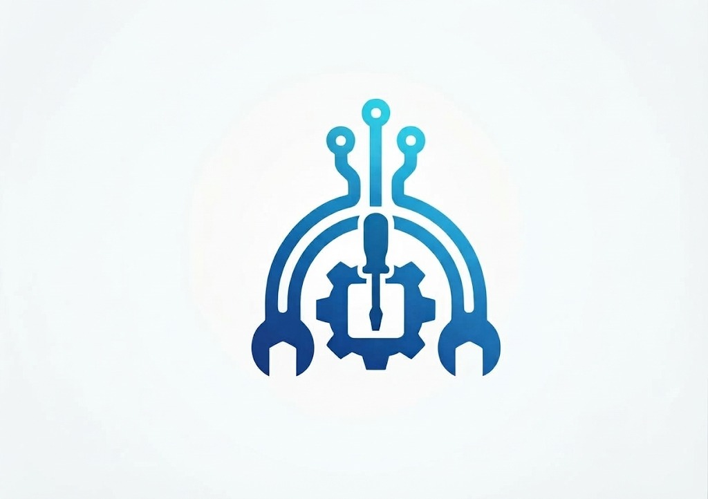

# FixPoint Service

<p align="center">
  
</p>

<h1 align="center">FixPoint Service</h1>
<p align="center"><strong>Sistem Informasi Booking &amp; Manajemen Jasa Servis Laptop dan PC</strong></p>

<p align="center">
  Laravel 13 &bull; PHP 8.3+ &bull; MySQL &bull; Blade
</p>

---

## Daftar Isi

1. [Deskripsi Aplikasi](#1-deskripsi-aplikasi)
2. [Latar Belakang Masalah](#2-latar-belakang-masalah)
3. [Tujuan Sistem](#3-tujuan-sistem)
4. [Fitur Utama](#4-fitur-utama)
5. [Aktor dan Hak Akses](#5-aktor-dan-hak-akses)
6. [Teknologi dan Versi](#6-teknologi-dan-versi)
7. [Arsitektur Sistem](#7-arsitektur-sistem)
8. [Struktur Direktori](#8-struktur-direktori)
9. [Persyaratan Instalasi](#9-persyaratan-instalasi)
10. [Instalasi Lokal](#10-instalasi-lokal)
11. [Konfigurasi Environment](#11-konfigurasi-environment)
12. [Konfigurasi Database](#12-konfigurasi-database)
13. [Migration](#13-migration)
14. [Seeder](#14-seeder)
15. [Build Asset](#15-build-asset)
16. [Menjalankan Aplikasi](#16-menjalankan-aplikasi)
17. [Akun Uji Coba](#17-akun-uji-coba)
18. [Pengujian Otomatis](#18-pengujian-otomatis)
19. [Menjalankan Tanpa Internet (Offline LAN)](#19-menjalankan-tanpa-internet-offline-lan)
20. [Tim Pengembang](#20-tim-pengembang)
21. [Struktur Dokumentasi](#21-struktur-dokumentasi)
22. [Status Deployment](#22-status-deployment)

---

## 1. Deskripsi Aplikasi

**FixPoint Service** adalah aplikasi web untuk mengelola operasional UMKM jasa servis laptop dan PC. Aplikasi menangani alur kerja dari pelanggan memesan jadwal servis, admin memproses diagnosis dan menetapkan biaya, pembayaran tunai maupun QRIS, hingga pemilik usaha membaca laporan pemasukan.

Pelanggan **tidak perlu membuat akun**. Setiap booking mendapat Service ID unik yang dipakai untuk memeriksa status servis. Admin dan Pemilik Usaha masuk melalui halaman login.

Aplikasi berjalan sebagai Laravel Web Monolithic: seluruh tampilan dirender di server dengan Blade, tanpa proses build JavaScript.

## 2. Latar Belakang Masalah

Pencatatan servis secara manual di buku dan chat menimbulkan masalah yang berulang di UMKM servis komputer:

- pelanggan harus berulang kali menanyakan status perangkatnya;
- nomor urut servis mudah tertukar antarperangkat;
- bukti pembayaran QRIS tersebar di galeri ponsel dan sulit dicocokkan dengan tagihan;
- laporan pemasukan bulanan harus dihitung ulang secara manual;
- riwayat servis satu perangkat tidak tersimpan sehingga sulit menangani keluhan berulang.

FixPoint Service menyatukan seluruh catatan tersebut dalam satu basis data sehingga setiap pihak melihat data yang sama.

## 3. Tujuan Sistem

1. Menyediakan kanal booking daring tanpa registrasi akun.
2. Memberi identitas unik (Service ID) pada setiap booking untuk pengecekan status.
3. Menyimpan data pelanggan, perangkat, keluhan, diagnosis, dan biaya servis secara terpusat.
4. Mencatat pembayaran tunai dan QRIS beserta bukti pembayarannya.
5. Menyediakan laporan riwayat servis dan pemasukan yang dapat diekspor ke PDF dan Excel.

## 4. Fitur Utama

### Halaman pelanggan

| Fitur | Keterangan |
| --- | --- |
| Beranda | Menampilkan layanan dan jadwal servis terdekat yang masih tersedia |
| Ketersediaan jadwal | Menampilkan status setiap slot: `AVAILABLE`, `FULL`, atau `CLOSED` |
| Booking | Formulir booking tanpa login, kuota jadwal dijaga dengan transaksi dan penguncian baris |
| Service ID | Dibuat otomatis dengan pola `FP-YYYYMMDD-XXXXX` dan dijamin unik |
| Cek status | Mencari booking berdasarkan Service ID, menampilkan progres servis dan rincian pembayaran |
| Unggah bukti QRIS | Mengunggah gambar bukti (JPG/PNG/WEBP, maksimal 2 MB) setelah servis selesai |
| Pembatalan | Pembatalan oleh pelanggan dengan alasan wajib, selama belum dikerjakan |

### Panel Admin

| Fitur | Keterangan |
| --- | --- |
| Dashboard | Statistik perlu tindakan, diagnosis, dikerjakan, dan belum dibayar |
| Jadwal servis | Menambah jadwal, menutup/membuka jadwal, mendeteksi benturan waktu |
| Kelola proses servis | Menerima booking, mengisi diagnosis, estimasi biaya, estimasi waktu, biaya akhir, dan status pengerjaan |
| Pembayaran | Konfirmasi tunai (dengan uang diterima) dan QRIS (wajib bukti), permintaan unggah ulang bukti |
| Struk | Struk siap cetak setelah pembayaran lunas |
| Data master | Data pelanggan, data perangkat, dan data layanan (tambah, ubah, aktif/nonaktif) |
| Riwayat servis | Filter rentang tanggal dan pencarian, ekspor PDF dan Excel |
| Pembatalan | Pembatalan booking oleh Admin dengan alasan tersimpan |

### Panel Pemilik Usaha (read-only)

| Fitur | Keterangan |
| --- | --- |
| Dashboard monitoring | Statistik servis aktif, menunggu, selesai, dan tagihan belum dibayar |
| Riwayat servis | Halaman, PDF, dan Excel |
| Laporan pemasukan | Hanya transaksi lunas, filter metode CASH/QRIS, PDF dan Excel |
| Bukti pembayaran | Pratinjau bukti QRIS tanpa hak mengubah data |

## 5. Aktor dan Hak Akses

| Aktor | Login | Hak akses |
| --- | --- | --- |
| Pelanggan | Tidak | Booking, cek status, unggah bukti QRIS, pembatalan booking yang belum dikerjakan |
| Admin | Ya (`role = ADMIN`) | Seluruh operasional dan data master, riwayat servis, struk, konfirmasi pembayaran |
| Pemilik Usaha | Ya (`role = PEMILIK_USAHA`) | Dashboard, riwayat servis, laporan pemasukan, bukti pembayaran (read-only) |

Pembatasan hak akses dijalankan middleware `role` (`app/Http/Middleware/RoleMiddleware.php`). Teknisi bukan aktor pengguna aplikasi; pekerjaan teknis dilakukan oleh Admin.

## 6. Teknologi dan Versi

| Komponen | Versi | Sumber |
| --- | --- | --- |
| PHP | `^8.3` (pengembangan: 8.4.26) | `composer.json` |
| Laravel Framework | `^13.17` (terpasang 13.36.0) | `composer.json`, `composer.lock` |
| MySQL / MariaDB | Database `fixpoint_service` | `.env`, migration |
| Blade | Template engine bawaan Laravel | `resources/views` |
| barryvdh/laravel-dompdf | `^3.1` | Ekspor PDF laporan |
| laravel/sanctum | `^4.0` | Terpasang dari skeleton, belum dipakai alur aplikasi |
| laravel/tinker | `^3.0` | REPL pengembangan |
| PHPUnit | `^12.5.12` | Pengujian otomatis |
| Composer | 2.10.3 (lingkungan pengembangan) | `composer -V` |
| Vite/Tailwind | Terdaftar di `package.json`, **tidak dipakai** (tidak ada `@vite` di view) | `package.json`, `resources/views` |

Aplikasi tidak membutuhkan Node.js maupun `npm run build` untuk berjalan.

## 7. Arsitektur Sistem

```
Browser (HTML/CSS/JS dari Blade)
        |  HTTP: GET/POST/PUT/PATCH (session + CSRF)
        v
public/index.php  ->  bootstrap/app.php (routing, middleware, exception handler)
        |
        v
routes/web.php  --(middleware auth, role)-->  Controller
        |                                          |
        |                                          +--> Model / Query Builder --> MySQL
        v
resources/views (Blade)  -->  HTML response
```

- **Model** (`app/Models`) memetakan tabel MySQL dengan primary key kustom (`user_id`, `booking_id`, dan seterusnya).
- **Controller** (`app/Http/Controllers`) memvalidasi input, menjalankan query, dan membungkus operasi multi-tabel dengan `DB::transaction()`.
- **View** (`resources/views`) berisi Blade dengan CSS tertanam dan JavaScript minimal (toggle password, toggle sidebar, modal konfirmasi).
- **Middleware** `role` membatasi area Admin dan Pemilik Usaha.
- **Laporan** memakai Query Builder dengan join beberapa tabel dan diekspor melalui dompdf (PDF) serta `App\Support\SimpleXlsx` (XLSX tanpa dependensi tambahan).

## 8. Struktur Direktori

```
fixpoint-service/
├── app/
│   ├── Http/Controllers/          Controller web dan Api/ApiBookingController
│   ├── Http/Middleware/           RoleMiddleware
│   ├── Models/                    Booking, Customer, Device, Payment, Schedule,
│   │                              Service, ServiceRecord, User
│   └── Support/SimpleXlsx.php     Pembuat berkas XLSX
├── bootstrap/app.php              Routing, alias middleware, exception handler
├── config/                        Konfigurasi Laravel
├── database/
│   ├── migrations/                10 migration (9 tabel + indeks pelaporan)
│   └── seeders/                   DatabaseSeeder, UserSeeder
├── deploy/                        Berkas bantu deployment
│   └── infinityfree/              htdocs.htaccess, env.production.example, schema SQL
├── docs/                          Dokumentasi Sprint 3 dan Sprint 4
├── public/                        Document root: index.php, .htaccess, images, qris
├── resources/views/               Seluruh tampilan Blade
├── routes/                        web.php, api.php, console.php
├── storage/                       Log, cache, dan unggahan (app/public)
├── tests/                         Pengujian fitur dan unit
├── tools/docs/                    Sumber markdown dan generator DOCX/PDF dokumentasi
├── artisan
├── composer.json
├── run_local_offline.bat          Menjalankan aplikasi untuk LAN tanpa internet
└── README.md
```

## 9. Persyaratan Instalasi

| Kebutuhan | Versi minimal |
| --- | --- |
| PHP | 8.3 (disarankan 8.4) |
| Ekstensi PHP | `openssl`, `pdo`, `pdo_mysql`, `mbstring`, `tokenizer`, `xml`, `ctype`, `json`, `fileinfo`, `zip`, `dom`, `libxml` |
| Composer | 2.x |
| MySQL / MariaDB | 5.7+ / 10.3+ |
| Git | 2.x |

Node.js tidak diperlukan.

## 10. Instalasi Lokal

```bash
git clone https://github.com/davinsolehpermana-code/fixpoint-service.git
cd fixpoint-service
composer install
cp .env.example .env
php artisan key:generate
```

Kemudian sesuaikan `.env` (lihat bagian 11 dan 12), buat database, lalu jalankan migration dan seeder.

Pada Windows dengan Git Bash, perintah `cp` di atas dapat diganti `copy .env.example .env` di Command Prompt.

## 11. Konfigurasi Environment

Nilai minimal yang harus benar pada `.env`:

```env
APP_NAME="FixPoint Service"
APP_ENV=local
APP_KEY=base64:...
APP_DEBUG=true
APP_URL=http://127.0.0.1:8000

DB_CONNECTION=mysql
DB_HOST=127.0.0.1
DB_PORT=3306
DB_DATABASE=fixpoint_service
DB_USERNAME=root
DB_PASSWORD=

SESSION_DRIVER=file
CACHE_STORE=file
QUEUE_CONNECTION=file
FILESYSTEM_DISK=local
```

Penting: gunakan `SESSION_DRIVER=file`, `CACHE_STORE=file`, dan `QUEUE_CONNECTION=file`/`sync`. Migration proyek **tidak** membuat tabel `sessions`, `cache`, maupun `jobs`, sehingga driver `database` akan gagal pada instalasi baru (`.env.example` masih membawa nilai bawaan skeleton `database`).

Jangan meng-commit berkas `.env`. Untuk production, gunakan `deploy/infinityfree/env.production.example` sebagai acuan.

## 12. Konfigurasi Database

```sql
CREATE DATABASE fixpoint_service CHARACTER SET utf8mb4 COLLATE utf8mb4_unicode_ci;
```

Sesuaikan `DB_DATABASE`, `DB_USERNAME`, dan `DB_PASSWORD` pada `.env`, lalu uji:

```bash
php artisan migrate:status
```

## 13. Migration

```bash
php artisan migrate
```

Menjalankan 10 migration: `users`, `customers`, `services`, `schedules`, `devices`, `bookings`, `service_records`, `payments`, `personal_access_tokens`, dan indeks pelaporan.

> Jangan memakai `migrate:fresh` pada database yang sudah berisi data, karena seluruh tabel akan dihapus. Untuk keperluan pengujian destruktif, gunakan database terpisah.

Skema juga tersedia sebagai berkas SQL untuk impor manual: `deploy/infinityfree/fixpoint_service_schema.sql`.

## 14. Seeder

```bash
php artisan db:seed
```

`DatabaseSeeder` bersifat idempoten (`firstOrCreate`) dan membuat:

- layanan `Servis Laptop` dan `Servis PC Desktop`;
- akun Admin dan Pemilik Usaha (lihat bagian 17).

`UserSeeder` memakai `create()` sehingga akan gagal bila akun sudah ada; tidak perlu dijalankan pada instalasi yang sudah memiliki akun.

## 15. Build Asset

Tidak diperlukan. Seluruh CSS dan JavaScript yang dipakai aplikasi berada di dalam berkas Blade, dan tidak ada direktif `@vite` pada `resources/views`. Perintah `npm install` dan `npm run build` tidak dibutuhkan untuk menjalankan atau men-deploy aplikasi.

## 16. Menjalankan Aplikasi

```bash
php artisan serve
```

Buka `http://127.0.0.1:8000`.

Untuk menjalankan dengan data siap pakai pada demonstrasi:

```bash
php artisan storage:link
php artisan serve
```

`storage:link` diperlukan agar berkas bukti pembayaran dapat dilayani dari disk `public`.

### Mode offline (tanpa internet)

```bash
run_local_offline.bat
```

Skrip memeriksa PHP, menyalakan MySQL lokal, memeriksa `.env` dan database, membersihkan cache, menyiapkan storage, menampilkan IP LAN yang sebenarnya, lalu menjalankan `php artisan serve --host 0.0.0.0 --port 8000`. Panduan lengkap: `docs/02-deployment/OFFLINE_DEPLOYMENT.md`.

## 17. Akun Uji Coba

Akun berikut **hanya untuk pengembangan lokal** dan dibuat oleh `DatabaseSeeder`:

| Email | Role | Password |
| --- | --- | --- |
| `admin@fixpoint.test` | ADMIN | `Admin12345` |
| `pemilik@fixpoint.test` | PEMILIK_USAHA | `Pemilik12345` |

Ganti password tersebut sebelum aplikasi dipasang pada hosting yang dapat diakses publik. Aplikasi tidak menyediakan akun demo untuk pelanggan karena pelanggan tidak melakukan login.

## 18. Pengujian Otomatis

```bash
php artisan test
```

Hasil terakhir pada repository ini: **30 pengujian lulus, 131 assertion**. Pengujian memakai SQLite in-memory sesuai `phpunit.xml` sehingga tidak menyentuh database pengembangan. Cakupan: autentikasi dan hak akses, validasi booking, alur status booking, laporan riwayat servis dan pemasukan (termasuk PDF dan XLSX), serta halaman error 403 dan 404.

## 19. Menjalankan Tanpa Internet (Offline LAN)

Untuk presentasi tanpa internet, jalankan `run_local_offline.bat` pada laptop, lalu buka alamat IP LAN yang ditampilkan skrip dari perangkat lain pada WiFi/hotspot yang sama. Rincian prasyarat, pengujian, dan penanganan firewall ada pada `docs/02-deployment/OFFLINE_DEPLOYMENT.md`.

## 20. Tim Pengembang

| Nama | Peran | Tanggung jawab utama |
| --- | --- | --- |
| Davin Soleh Permana | Backend | Database dan migration, model dan relasi, controller, routing, middleware, autentikasi dan otorisasi, validasi server-side, transaksi database, pembayaran, unggah bukti, laporan PDF/Excel, pengujian |
| Lutvi | Frontend | Layout dan partial Blade, form dan integrasi ke route, CSS, JavaScript interaksi, dashboard Admin dan Pemilik Usaha, tampilan responsif, tampilan cetak struk |

## 21. Struktur Dokumentasi

```
docs/
├── 01-release/
│   └── BUG_FIXING_LOG.md                     Log perbaikan bug dan status Code Freeze
├── 02-deployment/
│   ├── DEPLOYMENT_GUIDE.md                   Panduan deployment InfinityFree + status
│   └── OFFLINE_DEPLOYMENT.md                 Fallback lokal tanpa internet
├── 03-manual/
│   ├── USER_MANUAL.pdf                       Manual pengguna (disiapkan terpisah)
│   ├── TECHNICAL_DOCS.docx                   Dokumentasi teknis (dapat diedit)
│   └── TECHNICAL_DOCS.pdf                    Dokumentasi teknis (siap cetak, A4)
├── 04-api/
│   ├── API_DOCUMENTATION.md                  Data contract route web + endpoint JSON
│   └── fixpoint_service_api_collection.json  Postman collection (endpoint yang ada)
├── 05-defense/
│   ├── INDIVIDUAL_DEFENSE_CHECKLIST.docx     Checklist pertanggungjawaban individu
│   ├── INDIVIDUAL_DEFENSE_CHECKLIST.pdf      Versi cetak
│   └── TECHNICAL_QA.md                       Tanya jawab teknis lengkap
├── sprint-3/                                 Artefak Sprint 3 (tidak diubah)
└── demo-rehearsal/                           Catatan demo (di luar lingkup Sprint 4)
```

Dokumen DOCX/PDF dihasilkan dari sumber markdown di `tools/docs/` dengan perintah:

```bash
php tools/docs/build.php tools/docs/technical-docs.md docs/03-manual/TECHNICAL_DOCS
php tools/docs/build.php tools/docs/defense-checklist.md docs/05-defense/INDIVIDUAL_DEFENSE_CHECKLIST
```

## 22. Status Deployment

**Aplikasi belum dipublikasikan ke hosting.** Repository ini belum memiliki URL publik, dan tidak ada URL atau badge status deployment yang diklaim berjalan.

Yang sudah disiapkan:

- paket aplikasi production (`composer install --no-dev --optimize-autoloader`, `php artisan optimize`);
- berkas konfigurasi hosting: `deploy/infinityfree/htdocs.htaccess` dan `deploy/infinityfree/env.production.example`;
- skema database siap impor: `deploy/infinityfree/fixpoint_service_schema.sql`;
- prosedur unggah dan daftar pengujian pascadeploy pada `docs/02-deployment/DEPLOYMENT_GUIDE.md`.

Target hosting yang dipilih adalah InfinityFree (PHP 8.4, MySQL, tanpa SSH/Composer/Artisan, document root `htdocs`). Unggah belum dilakukan karena tidak tersedia akses akun hosting pada lingkungan pengerjaan; langkah yang tersisa dijelaskan pada bagian 6 panduan deployment.
